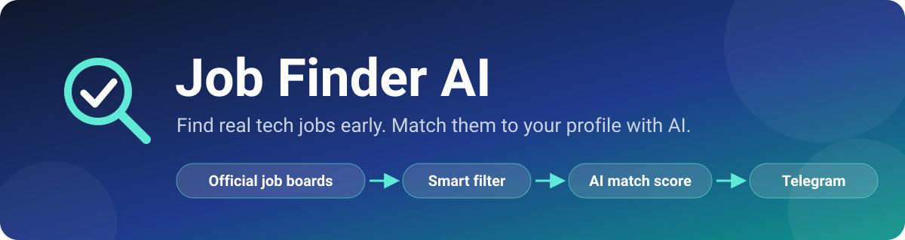
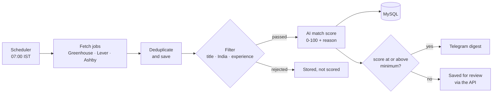
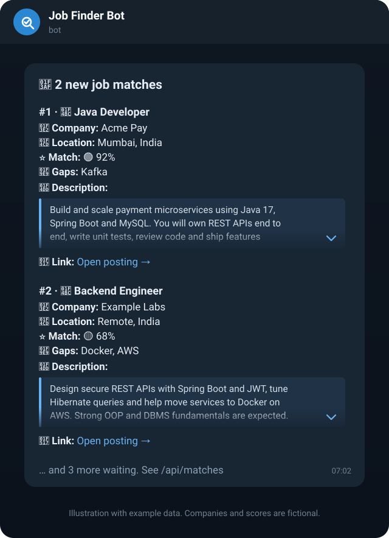
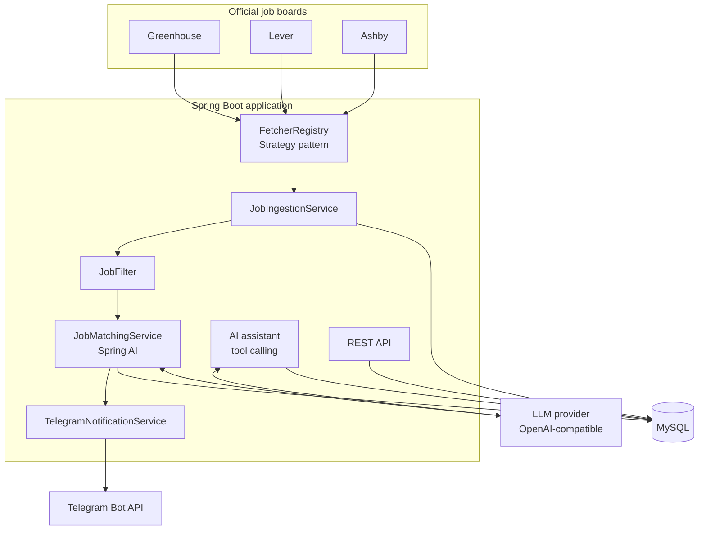
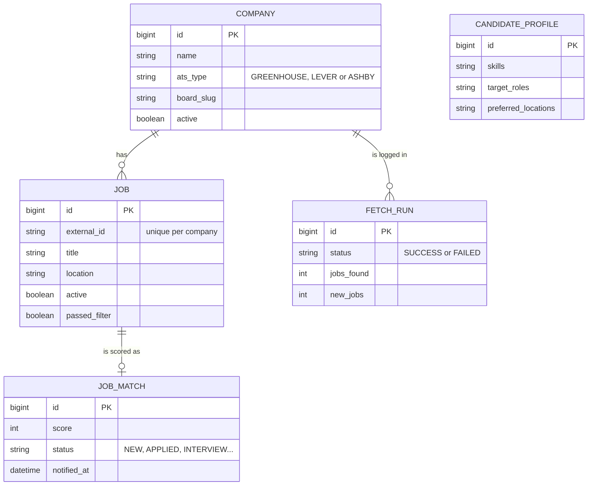
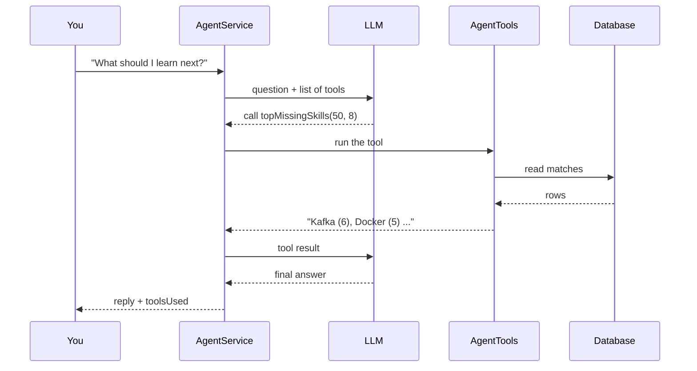

<div align="center">



# Job Finder AI

**An AI-assisted job-matching pipeline built with Java, Spring Boot and Spring AI.**

It reads real openings straight from company career boards, filters them to what you want,
scores each one against your profile with an LLM, and sends the best matches to your phone on Telegram.

<br/>


[Overview](#overview) ·
[Features](#features) ·
[How it works](#how-it-works) ·
[Quick start](#quick-start) ·
[API](#api-reference) ·
[Tests](#testing) ·
[Roadmap](#roadmap)

</div>

---

## Table of contents

1. [Overview](#overview)
2. [Features](#features)
3. [How it works](#how-it-works)
4. [What you receive on Telegram](#what-you-receive-on-telegram)
5. [Architecture and design decisions](#architecture-and-design-decisions)
6. [Tech stack](#tech-stack)
7. [Project structure](#project-structure)
8. [Quick start](#quick-start)
9. [Using the app: first run](#using-the-app-first-run)
10. [Configuration reference](#configuration-reference)
11. [API reference](#api-reference)
12. [AI assistant (tool calling)](#ai-assistant-tool-calling)
13. [Testing](#testing)
14. [Security and privacy](#security-and-privacy)
15. [Troubleshooting](#troubleshooting)
16. [Roadmap](#roadmap)
17. [Known limitations](#known-limitations)
18. [Contributing, license and author](#contributing-license-and-author)

---

## Overview

### The problem

Popular job sites are crowded. A good opening can collect thousands of applications in a day,
and some listings are stale, duplicated or fake. Checking dozens of company career pages by hand
every morning is slow, and it is easy to miss a role that was posted only hours ago.

### The approach

**Job Finder AI automates the boring part and keeps a human in charge of the decision.**

1. It reads openings from the **official public job-board APIs** of Greenhouse, Lever and Ashby.
   Every listing links to the company's own application page. Nothing is scraped from social job sites.
2. It stores each job once, remembers what it has already seen, and closes jobs that disappear.
3. A configurable **filter** removes anything that is not a software role in your target locations
   or that asks for more experience than you have.
4. An **LLM scores** each remaining job against your profile (skills, target roles, locations),
   and explains the score and the missing skills.
5. The best new matches arrive as **one Telegram message**, best first, each job sent at most once.

> [!NOTE]
> This is a personal learning and portfolio project. It is a decision-support tool:
> an AI score is an opinion that helps you sort jobs, and you should still read each job yourself.

---

## Features

| Area | What it does |
|---|---|
| **Official sources only** | Greenhouse, Lever and Ashby public job-board APIs. One `JobFetcher` per source, chosen at runtime (Strategy pattern) |
| **30+ companies pre-configured** | A seeder adds companies, with Mumbai-based and India-hiring companies first. Any company on a supported board can be added with one API call |
| **Safe, repeatable ingestion** | Each job is stored once (unique per company and external id). Jobs that disappear are closed (soft delete) and reopen if they return |
| **Run diary** | Every fetch is recorded as `SUCCESS` or `FAILED` with the error. One broken company never stops the run |
| **Smart filter** | Whole-word title rules, India location rules and an experience limit. All rules live in YAML, and a diagnose endpoint explains why jobs were rejected |
| **Profile-aware AI scoring** | Spring AI structured output: score 0 to 100, a short reason, matched skills and missing skills |
| **Cost and safety controls** | Filter first, cap per run, stop after repeated failures, truncated descriptions, and no name or email sent to the AI |
| **Application tracker** | Statuses `NEW`, `APPLIED`, `INTERVIEW`, `REJECTED`, `IGNORED` |
| **Telegram digest** | One message with the top matches, HTML formatted, with a safe "send first, mark after" rule |
| **AI assistant** | A chat endpoint where the LLM chooses from 7 tools (search matches, skill gaps, update a status) with a call budget and conversation memory |
| **Scheduler** | Runs automatically (default 07:00 IST) and can be triggered manually |
| **Tested** | Unit tests with JUnit 5 and Mockito, plus Spring slice tests (see [Testing](#testing)) |

---

## How it works



| Step | What happens | Why it matters |
|---|---|---|
| 1. Fetch | For every active company, the right fetcher calls the official API and converts the result to one common shape (`NormalizedJob`) | Adding a new job source never touches the rest of the code |
| 2. Ingest | New jobs are saved, known jobs are refreshed, missing jobs are closed | You are only ever told about jobs that are actually new |
| 3. Filter | Title words, location words and years of experience are checked, and each job gets a pass or fail label with a reason | Keeps the AI bill small, because only relevant jobs are scored |
| 4. Score | The LLM compares your profile with the job and returns structured JSON | Ranks jobs by fit and shows what to learn next |
| 5. Notify | The best unsent matches are formatted into one message and sent | The jobs reach you without opening anything |

Every run is logged. `GET /api/runs` shows which companies succeeded or failed and why.

---

## What you receive on Telegram

<div align="center">

</div>

Each entry shows the AI score, the job title, the company and location, the skills you are missing,
and an **Apply** link to the company's own page. The image above is an illustration with example data.

---

## Architecture and design decisions



### Data model



### Key decisions

| Decision | Reason |
|---|---|
| **Strategy pattern for job sources** | A new source is one new class that implements `JobFetcher`. The registry discovers it automatically |
| **One common `NormalizedJob`** | Dedupe, filtering, scoring and notifications never need to know where a job came from |
| **Soft delete for closed jobs** | Keeps history, and a re-opened job comes back without creating a duplicate |
| **Unique constraint on (company, external id)** | The database protects against duplicates even if the code has a bug |
| **Filter before the LLM** | A cheap rule-based pass removes most jobs, so only a few dozen are scored |
| **Structured LLM output** | The model must fill a typed record (`MatchResult`), and the result is clamped and cleaned before use |
| **Pure logic separated from I/O** | The filter, prompt builder and message formatter need no database or network, so they are tested in milliseconds |
| **Fault isolation** | A failing company, AI call or Telegram call is recorded, and the rest of the run continues |
| **Send first, mark after** | A Telegram message is marked as sent only after delivery succeeds, so a failure never loses a job |
| **Secrets from environment variables** | Keys never live in files that go to Git, and the Telegram token is scrubbed from error messages |
| **Untrusted text is treated as data** | Job text is cleaned and fenced in the prompt, and the AI assistant can only call a small set of tools |

---

## Tech stack

| Layer | Technology |
|---|---|
| Language and build | Java 21, Maven (wrapper included) |
| Framework | Spring Boot (Web, Data JPA, Validation, Scheduling) |
| AI | Spring AI with an OpenAI-compatible chat model (`ChatClient`, structured output, tool calling) |
| Database | MySQL 8 with Hibernate (schema generated by `ddl-auto: update`) |
| HTTP clients | Spring `RestClient` with timeouts |
| Utilities | Lombok, Jsoup (HTML cleaning), Apache PDFBox (optional resume PDF to text) |
| Notifications | Telegram Bot API |
| Testing | JUnit 5, Mockito, MockMvc, `MockRestServiceServer`, H2 for repository tests |

---

## Project structure

```text
job-finder-ai/
├── docs/
│   └── images/                  # README images
├── src/
│   ├── main/
│   │   ├── java/com/project/job_finder_ai/
│   │   │   ├── agent/           # AI assistant: tools, memory, prompt, controller
│   │   │   ├── config/          # typed settings and beans (filter, match, telegram, HTTP, AI)
│   │   │   ├── controller/      # REST controllers
│   │   │   ├── dto/             # request and response shapes
│   │   │   ├── entity/          # JPA entities (Company, Job, JobMatch, FetchRun, CandidateProfile)
│   │   │   ├── enums/           # AtsType, RunStatus, ApplicationStatus
│   │   │   ├── exception/       # custom exceptions and the global error handler
│   │   │   ├── repository/      # Spring Data repositories and query specifications
│   │   │   ├── service/         # business logic: fetchers, ingestion, filter, scoring, notifications
│   │   │   └── utils/           # helpers and the company seeder
│   │   └── resources/
│   │       └── application.yml
│   └── test/java/               # unit and slice tests
├── pom.xml
└── README.md
```

> [!TIP]
> Package names in your copy may differ slightly. The idea is the same: controllers call services,
> services call repositories and external clients, and pure logic classes have no I/O.

---

## Quick start

### 1. Prerequisites

| Tool | Version | Notes |
|---|---|---|
| **JDK** | **21** or newer | Check with `java -version` |
| **Maven** | 3.9+ | Optional, because the project includes `./mvnw` |
| **MySQL** | **8.x** | Local install or any MySQL 8 server |
| **IDE** | IntelliJ IDEA (Community is enough) | VS Code or Eclipse also work |
| **Lombok** | IDE plugin and annotation processing on | Bundled in current IntelliJ versions |
| **Telegram account** | any | To create your own bot |
| **LLM API key** | OpenAI or any OpenAI-compatible provider | The model must support tool calling if you use the assistant |
| **Postman** or `curl` | any | To call the API |

**Spring Boot and Spring AI versions must match.** Check the `<parent>` version in `pom.xml`:

| Spring Boot | Spring AI | Notes |
|---|---|---|
| 4.0.x and 4.1.x | 2.0.x | Test starters are modular on Boot 4 |
| 3.4.x and 3.5.x | 1.1.x | The older generation |

Mixing generations fails at startup with errors such as `NoSuchMethodError`.

### 2. Get the code

```bash
git clone https://github.com/YOUR-USERNAME/job-finder-ai.git
cd job-finder-ai
```

### 3. Create the database

Run this in MySQL (DBeaver, MySQL Workbench or the `mysql` shell):

```sql
CREATE DATABASE jobfinder CHARACTER SET utf8mb4 COLLATE utf8mb4_unicode_ci;
CREATE USER 'jobfinder'@'localhost' IDENTIFIED BY 'change-me';
GRANT ALL PRIVILEGES ON jobfinder.* TO 'jobfinder'@'localhost';
FLUSH PRIVILEGES;
```

Hibernate creates the tables automatically on the first start.

### 4. Create your Telegram bot (10 minutes)

1. In Telegram, open **@BotFather** and send `/newbot`. Choose a name and a username ending in `bot`.
2. Copy the **bot token** that BotFather returns. It is a secret.
3. Open your new bot, press **Start**, and send it any message such as `hi`.
4. Open `https://api.telegram.org/bot<TOKEN>/getUpdates` in a browser and find
   `"chat":{"id":123456789,...}` in the entry where `"is_bot"` is `false`.
   That number is **your chat id**.

> [!WARNING]
> The chat id must be **your own** id. Do not use the number before the colon in the token or
> the `id` from `getMe`. Those belong to the bot, and Telegram answers with
> `403 Forbidden: bot can't send messages to bots`.

### 5. Set your secrets

Secrets are read from **environment variables**, so nothing sensitive is committed.

| Variable | Meaning |
|---|---|
| `DB_USERNAME` | MySQL user (example: `jobfinder`) |
| `DB_PASSWORD` | MySQL password |
| `AI_API_KEY` | Your LLM provider key |
| `TELEGRAM_BOT_TOKEN` | Token from BotFather |
| `TELEGRAM_CHAT_ID` | Your chat id |

**IntelliJ:** *Run, Edit Configurations, select the Spring Boot configuration, Environment variables*, then enter
`DB_USERNAME=jobfinder;DB_PASSWORD=change-me;AI_API_KEY=...;TELEGRAM_BOT_TOKEN=...;TELEGRAM_CHAT_ID=...`
(no quotes, no spaces around `=`).

**Terminal (macOS, Linux, Git Bash):**
```bash
export DB_USERNAME=jobfinder DB_PASSWORD=change-me AI_API_KEY=... \
       TELEGRAM_BOT_TOKEN=... TELEGRAM_CHAT_ID=...
```

**Terminal (Windows PowerShell):**
```powershell
$env:DB_USERNAME="jobfinder"; $env:DB_PASSWORD="change-me"; $env:AI_API_KEY="..."
$env:TELEGRAM_BOT_TOKEN="..."; $env:TELEGRAM_CHAT_ID="..."
```

### 6. Configure the app

Open `src/main/resources/application.yml` and set at least your **model name**.
A complete example is in [Configuration reference](#configuration-reference).

```yaml
match:
  model: YOUR-MODEL-NAME     # copy a current model name from your AI provider
```

For an OpenAI-compatible provider that is not OpenAI, also set `spring.ai.openai.base-url`.

### 7. Run

**IntelliJ IDEA**

1. *File, Open*, and select the project folder. Wait for Maven to import.
2. *File, Project Structure*: set the SDK to **Java 21**.
3. *Settings, Build, Compiler, Annotation Processors*: tick **Enable annotation processing** (needed by Lombok).
4. Open the main class (`JobFinderAiApplication`) and click the green **Run** arrow.

**Command line**

```bash
./mvnw spring-boot:run          # macOS, Linux, Git Bash
.\mvnw.cmd spring-boot:run      # Windows
```

The app starts on **http://localhost:8080**. On the first start, the seeder adds the pre-configured companies.
The console should say `DataSeeder added N new companies`.

### 8. Verify the setup

```bash
curl http://localhost:8080/api/companies                          # lists the seeded companies
curl -X POST http://localhost:8080/api/admin/telegram-test        # a test message should reach your phone
```

---

## Using the app: first run

**1. Save your profile.** The AI compares every job with it. Leave out your phone number and address,
because the resume text is sent to the AI provider. Your name and email are never included in AI requests.

```bash
curl -X PUT http://localhost:8080/api/profile \
  -H "Content-Type: application/json" \
  -d '{
    "fullName": "Your Name",
    "email": "you@example.com",
    "yearsOfExperience": 0.5,
    "skills": ["Java", "Spring Boot", "MySQL", "REST APIs", "Git"],
    "targetRoles": ["Java Developer", "Backend Engineer", "SDE Intern"],
    "preferredLocations": ["Mumbai", "Pune", "Bengaluru", "Remote (India)"],
    "resumeText": "Java developer with internship experience. Built a REST API with Spring Boot and MySQL. ..."
  }'
```

**2. Run the pipeline** (fetch, filter, score, notify). It takes a minute or two:

```bash
curl -X POST http://localhost:8080/api/admin/run
```

**3. See what happened.** Failed companies show their error here:

```bash
curl http://localhost:8080/api/runs
```

**4. Read your best matches:**

```bash
curl "http://localhost:8080/api/matches?minScore=60&limit=10"
```

```json
[
  {
    "id": 12,
    "jobId": 481,
    "title": "Java Developer",
    "company": "Example Company",
    "location": "Mumbai, India",
    "applyUrl": "https://...",
    "score": 82,
    "reason": "Strong Java and Spring Boot match; the role also asks for Kafka.",
    "matchedSkills": ["Java", "Spring Boot", "REST APIs"],
    "missingSkills": ["Kafka"],
    "status": "NEW",
    "scoredAt": "2026-11-14T16:00:44Z"
  }
]
```

**5. Track what you did:**

```bash
curl -X PATCH "http://localhost:8080/api/matches/12/status?value=APPLIED"
```

**6. Get alerts.** Once Telegram is configured, the scheduler runs every morning. You can also send the
digest on demand with `POST /api/admin/notify`.

> [!TIP]
> Not seeing the jobs you expect? Open `GET /api/filter/rules` to see the active filter, and
> `GET /api/filter/diagnose?titleContains=intern` to see why jobs were rejected.

---

## Configuration reference

<details>
<summary><b>Full <code>application.yml</code> example (click to expand)</b></summary>

```yaml
server:
  port: 8080

spring:
  datasource:
    url: jdbc:mysql://localhost:3306/jobfinder?allowPublicKeyRetrieval=true&useSSL=false
    username: ${DB_USERNAME:jobfinder}
    password: ${DB_PASSWORD:}
  jpa:
    hibernate:
      ddl-auto: update
    show-sql: false
  servlet:
    multipart:
      max-file-size: 2MB
      max-request-size: 2MB
  ai:
    openai:
      api-key: ${AI_API_KEY}
      # base-url: https://your-provider.example/v1   # only for OpenAI-compatible providers
    retry:
      max-attempts: 3                                # optional: limits automatic retries

# When the pipeline runs and how politely it calls company boards
pipeline:
  cron: "0 0 7 * * *"          # second minute hour day month weekday  (every day at 07:00)
  zone: Asia/Kolkata
  pause-millis: 500            # pause between companies

# Which jobs are worth scoring
filter:
  max-years: 3
  include-title-words: [java, spring, backend, "back end", back-end, sde, "software engineer",
                        "software developer", "software development engineer", "full stack",
                        fullstack, "application developer", developer, programmer]
  exclude-title-words: [senior, sr, staff, principal, lead, manager, director, head, architect,
                        vp, iii, iv, sales, marketing, recruiter, recruitment, talent, hr,
                        "human resources", onboarding, customer, support, collections, telecaller,
                        executive, accountant, finance, legal, business, content, "social media"]
  india-location-words: [india, bengaluru, bangalore, hyderabad, pune, mumbai, chennai, gurgaon,
                         gurugram, noida, delhi, kolkata, ahmedabad, thane, bombay]

# AI scoring
match:
  model: YOUR-MODEL-NAME
  # temperature: 0.2           # leave unset if your model only accepts its default
  max-description-chars: 6000
  max-resume-chars: 8000
  max-per-run: 20              # cost cap: at most this many jobs scored per run
  max-consecutive-failures: 3  # stop scoring early if the AI keeps failing
  pause-millis: 300

# Telegram digest
telegram:
  enabled: true
  bot-token: ${TELEGRAM_BOT_TOKEN:}
  chat-id: ${TELEGRAM_CHAT_ID:}
  min-score: 70
  max-jobs-per-message: 10

# AI assistant
agent:
  enabled: true
  model:                       # optional: empty means "reuse match.model"
  max-tool-calls: 8
  max-message-chars: 500
  max-results-per-tool: 15
  max-remembered-turns: 6
```

</details>

### The settings you will change most

| Setting | Default | Effect |
|---|---|---|
| `pipeline.cron` | `0 0 7 * * *` | When the automatic run starts. `0 0 */3 * * *` means every 3 hours |
| `filter.max-years` | `3` | Jobs asking for more years of experience are rejected |
| `filter.include-title-words` | tech words | A title needs **one** of these words. Use job-type words only, never level words like `intern` |
| `filter.exclude-title-words` | seniority and non-tech words | One match rejects the job |
| `match.max-per-run` | `20` | Upper limit on AI calls per run |
| `telegram.min-score` | `70` | Smallest score that is worth a message. Lower it (for example 55) if your real scores run lower |
| `telegram.max-jobs-per-message` | `10` | Jobs in one digest. The rest wait for the next one |

> [!IMPORTANT]
> Rules are read at startup. After changing `application.yml`, restart the app and call
> `POST /api/admin/refilter` so already-saved jobs are re-checked with the new rules.

### Adding or removing companies

The seeder (`DataSeeder`) lists the pre-configured companies, grouped by priority (Mumbai first, then other
Indian cities, then remote or global). To add one without touching code:

```bash
curl -X POST http://localhost:8080/api/companies -H "Content-Type: application/json" \
  -d '{"name":"Example Co","atsType":"LEVER","boardSlug":"example","careersUrl":"https://jobs.lever.co/example"}'
```

The **board slug** is the company's id on its job board, taken from the careers URL
(`jobs.lever.co/<slug>`, `job-boards.greenhouse.io/<slug>`, `jobs.ashbyhq.com/<slug>`).
It is often not the brand name. Turn a company off with `PATCH /api/companies/{id}/active?value=false`.

---

## API reference

<details>
<summary><b>Companies, jobs and runs</b></summary>

| Method and path | Purpose |
|---|---|
| `GET /api/companies` | List all companies |
| `POST /api/companies` | Add a company (`name`, `atsType`, `boardSlug`, `careersUrl`) |
| `PATCH /api/companies/{id}/active?value=true` | Switch a company on or off |
| `GET /api/jobs` | Search jobs. Filters: `companyId`, `keywords` (comma separated), `location`, `department`, `indiaOnly`, `passedFilter`, `limit` |
| `GET /api/runs?companyId=` | The run diary (last 50 fetches) |

</details>

<details>
<summary><b>Pipeline and admin</b></summary>

| Method and path | Purpose |
|---|---|
| `POST /api/admin/run` | Full pipeline: fetch, filter, score, notify |
| `POST /api/admin/run/{companyId}` | Fetch one company only |
| `POST /api/admin/refilter` | Re-apply the filter rules to all saved jobs |
| `POST /api/admin/score-pending` | Score the next batch of filtered, unscored jobs |
| `POST /api/admin/notify` | Send the Telegram digest now |
| `POST /api/admin/telegram-test` | Send a test message to check your bot setup |
| `GET /api/admin/telegram-config` | Show what the app sees, with the secret part of the token hidden |

</details>

<details>
<summary><b>Filter</b></summary>

| Method and path | Purpose |
|---|---|
| `GET /api/filter/rules` | The active rules |
| `POST /api/filter/check` | Test a made-up job: `{"title":"...","location":"...","description":"..."}` |
| `GET /api/filter/diagnose?titleContains=intern` | Counts and samples of why jobs were rejected |

</details>

<details>
<summary><b>Profile, matches and scoring</b></summary>

| Method and path | Purpose |
|---|---|
| `PUT /api/profile` | Create or update the single candidate profile |
| `GET /api/profile` | Read it |
| `POST /api/profile/resume/extract` | Upload a PDF (form field `file`) and get its text back to review before saving |
| `GET /api/matches?minScore=&status=&limit=` | Matches, best score first |
| `GET /api/matches/{id}` | One match |
| `PATCH /api/matches/{id}/status?value=APPLIED` | Change the status (`NEW`, `APPLIED`, `INTERVIEW`, `REJECTED`, `IGNORED`) |
| `GET /api/match/preview/{jobId}` | Show the exact text that would be sent to the AI (no AI call, no cost) |
| `POST /api/match/test/{jobId}` | Score one job right now |

</details>

<details>
<summary><b>AI assistant</b></summary>

| Method and path | Purpose |
|---|---|
| `POST /api/agent/chat` | Ask a question: `{"conversationId":"me","message":"What should I learn next?"}` |
| `DELETE /api/agent/conversations/{id}` | Forget a conversation |

</details>

**Errors** come back as JSON: validation problems as `400` with a message per field, and other problems as
`{"error": "..."}` with `404` (not found), `409` (duplicate or run already in progress) or `502` (AI or Telegram unavailable).

---

## AI assistant (tool calling)

The assistant is where the **AI decides what to do next**. It receives your question and a list of tools,
calls the ones it needs (our Java methods running against your own database), reads the results, and writes
the answer. The loop is handled by Spring AI.



| Tool | Reads or writes | Purpose |
|---|---|---|
| `getMyProfile` | read | Skills, target roles, experience, cities (no name, email or resume) |
| `searchMatches` | read | Matches by score and status |
| `getMatchDetails` | read | One match in full |
| `searchJobs` | read | Jobs by title words |
| `getStats` | read | Counts of companies, jobs and matches |
| `topMissingSkills` | read | The skills missing most often across your matches |
| `updateMatchStatus` | **write** | Change one match's status, only when you clearly ask |

```bash
curl -X POST http://localhost:8080/api/agent/chat -H "Content-Type: application/json" \
  -d '{"conversationId":"me","message":"What should I learn next?"}'
```

```json
{
  "conversationId": "me",
  "reply": "Across your matches, Kafka and Docker are missing most often. Docker is the quicker one to learn first.",
  "toolsUsed": ["topMissingSkills(minScore=50, top=8)"]
}
```

**Guard rails**

- A budget of 8 tool calls per question, so the model cannot loop forever.
- Only one write tool, with a fixed list of valid statuses.
- Tool output is short, flat text, and job text is treated as untrusted data (protection against prompt injection).
- Every tool is capped to a small number of results, and messages are length-limited.
- The reply shows `toolsUsed`, so you can always see what the assistant actually did.

> [!NOTE]
> The chosen model must support **tool calling**. Memory is kept in RAM, so it resets when the app restarts.

---

## Testing

```bash
./mvnw test                                     # run everything
./mvnw -Dtest=JobFilterTest test                # one class
./mvnw -Dtest=JobFilterTest#javascriptIsNotJava test   # one test
```

<!-- EDIT: keep only the rows for test types that exist in src/test/java -->

| Test type | Tools | Covers |
|---|---|---|
| Pure unit tests | JUnit 5 | Job filter rules, experience parser, prompt builders, message formatter, result cleaner, skill-gap counter |
| Service tests | JUnit 5 + Mockito | Ingestion (new, known and closed jobs), fetch fault isolation, pipeline, scoring batch, Telegram notifications, assistant tools |
| HTTP client tests | `MockRestServiceServer` | Greenhouse, Lever and Ashby parsing, and the Telegram request format |
| Web tests | `@WebMvcTest` + MockMvc | Validation, status codes and error JSON |
| Repository tests | `@DataJpaTest` + H2 | Custom queries and unique constraints |

The AI is never called in tests, so they are free and repeatable.

> [!NOTE]
> The generated `contextLoads()` test starts the whole application and needs a database and an AI key.
> Run the test classes by name, or disable that one test until integration tests are added (see [Roadmap](#roadmap)).

---

## Security and privacy

- **Secrets never go in Git.** Keys come from environment variables. Add local secret files to `.gitignore`.
- **The Telegram token is hidden.** Error messages replace it with `***`, because Telegram puts the token in the request address.
- **Minimal data goes to the AI.** Requests contain skills, roles, locations and resume text, never your name or email.
  Remove phone numbers and addresses from the resume text you save.
- **Third-party text is untrusted.** Job text is cleaned, length-limited and fenced inside the prompt,
  and the assistant has a small, fixed set of tools.
- **Polite to job boards.** One call per company per run, with a pause and timeouts.

> [!CAUTION]
> The REST API has **no authentication yet**. Anyone who can reach the app can read your matches and change
> a status. Run it on your own machine only, and do not expose port 8080 to the internet until
> authentication is added (see [Roadmap](#roadmap)).

Recommended `.gitignore` additions:

```gitignore
.env
application-local.yml
target/
.idea/
*.log
```

---

## Troubleshooting

<details>
<summary><b>Click to expand the common problems and fixes</b></summary>

| Symptom | Likely cause | Fix |
|---|---|---|
| `Public Key Retrieval is not allowed` (MySQL) | MySQL 8's password method needs SSL or key retrieval | Add `allowPublicKeyRetrieval=true&useSSL=false` to the JDBC URL (local development only) |
| `Could not resolve placeholder 'AI_API_KEY'` | Environment variable not set | Add it to the run configuration and restart |
| `Set match.model ... real model name` | Placeholder model name | Put a current model name from your provider in `match.model` |
| `NoSuchMethodError` at startup | Spring Boot and Spring AI generations mixed | Use the matching pair from the version table |
| AI call returns 404 | Wrong base URL for an OpenAI-compatible provider | On Spring AI 2.x the base URL usually ends with `/v1`. On 1.1.x it does not. Never include `/chat/completions` |
| AI call returns 401 | Wrong or missing key | Check `AI_API_KEY` and restart the app |
| AI call returns 400 mentioning temperature | The model accepts only its default | Remove `match.temperature` |
| Telegram `HTTP 401` | Bot token wrong, revoked or has hidden characters | Re-copy it from BotFather, with no quotes or spaces. `GET /api/admin/telegram-config` shows what the app sees |
| Telegram `403 ... can't send messages to bots` | The chat id is a bot's id | Use your own id from `getUpdates` (the entry with `"is_bot": false`) |
| Telegram `403 ... can't initiate conversation` | You never pressed Start | Open your bot and press **Start** |
| Telegram `400 chat not found` | Wrong chat id | Re-check it in `getUpdates` |
| `getUpdates` returns `"result":[]` | The message went to a different bot, a webhook is set, or another program reads the bot | Message exactly `@<your bot username>`, check `getWebhookInfo`, or revoke the token and use the new one |
| Nothing gets scored | No profile saved, no job passed the filter, or the cap is reached | Save a profile, check `GET /api/jobs?passedFilter=true`, call `POST /api/admin/score-pending` |
| Non-tech jobs appear in matches | A level word such as `intern` is in `include-title-words` | Keep only job-type words there, add non-tech words to the exclude list, then call `refilter` |
| "Nothing new to send" | No unsent match reaches `telegram.min-score` | Compare `GET /api/matches?minScore=0` with your minimum and lower it |
| A company shows `FAILED` in `/api/runs` | Wrong board slug, or no public board | Fix the slug or switch the company off |
| Lombok errors in the IDE | Annotation processing is off | Enable it in the IDE settings and rebuild |
| Port 8080 already in use | Another program uses it | Set `server.port` to another value |

</details>

---

## Roadmap

**Done**

- [x] Fetchers for Greenhouse, Lever and Ashby with a strategy registry
- [x] Idempotent ingestion, soft delete and a run diary
- [x] Configurable filter with explanations
- [x] Profile-aware LLM scoring with structured output
- [x] Match tracking and a Telegram digest
- [x] Scheduler and manual triggers
- [x] AI assistant with tool calling and guard rails
- [x] Unit and slice tests

**Planned**

- [ ] Docker and Docker Compose (app + database)
- [ ] Integration tests with Testcontainers
- [ ] Flyway database migrations instead of `ddl-auto: update`
- [ ] Authentication for the API (Spring Security)
- [ ] Freshness and ghost-job rules (only recent postings)
- [ ] A baseline run, so a new company's existing jobs are not announced as new
- [ ] Workday support (an undocumented endpoint, so it needs care)
- [ ] Retry after Telegram rate limits, and follow-up reminders after applying

---

## Known limitations

- **Coverage.** Only companies that use Greenhouse, Lever or Ashby are supported. Many large employers use their own portals.
- **Fresher roles are rare** on these boards, so some mornings produce no new matches. That is expected.
- **Scores are opinions.** An LLM can be wrong or vary slightly between runs. Use scores to sort, then read the job.
- **The experience rule is a heuristic.** It reads text such as "2-5 years of experience" and can miss unusual wording.
- **No login.** See the security note above.
- **The assistant's memory is temporary** and its quality depends on the model you choose.

---

## Contributing, license and author

Suggestions and pull requests are welcome. Please run `./mvnw test` before opening one.

**License:** MIT. Add a `LICENSE` file to the repository root (GitHub can create one for you from the *Add file* menu).

**Disclaimer:** this project uses only public job-board APIs and is not affiliated with any company listed in it.
Please respect each service's terms of use and keep the request rate low.

**Author**

<!-- EDIT: put your own name and links below -->

Built by **Vansh Kothari(https://github.com/VanshK162006)** · [LinkedIn](https://www.linkedin.com/in/vanshk162006) · [Email](vansh.kothari16@gmail.com)

If this project helped you, a star on the repository is appreciated.