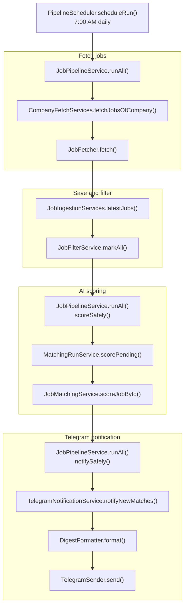

# Job Finder AI

An automated job finder. Every morning it fetches jobs from company career boards (Greenhouse, Lever, etc.), filters them, scores them against your candidate profile using AI, and sends the best matches to Telegram.

## How to read this document

| Style | Meaning | Example |
|---|---|---|
| **Bold** | Class / Service | **JobPipelineService** |
| `code` | Method | `runAll()` |
| ***Bold italic*** | DTO or Entity (data object) | ***NormalizedJob*** |

## Flow at a glance



---

## 1. Trigger

### PipelineScheduler `.scheduleRun()`

- Starts the whole pipeline automatically at 7:00 AM every day.
- It directly calls `runAll()` of **JobPipelineService**.
- When `runAll()` finishes, it logs how much time the run took and a summary of the result.

---

## 2. Fetch jobs

### JobPipelineService `.runAll()`

- This is the boss of the run. It does not fetch or score by itself, it calls other classes in the right order.
- First it loads all companies that are **Active** from the database.
- Then it runs a for-each loop over those companies.
- For each company it calls `CompanyFetchServices.fetchJobsOfCompany()`. Only jobs of that company that are not yet in the database get saved. These are the *latest jobs*.

**Out:** ***FetchRun*** summary for each company

> **Improvement:** wrap each company in its own try/catch, so one failing API does not stop the other companies.

### CompanyFetchServices `.fetchJobsOfCompany(Company company)`

- Receives one ***Company*** from `runAll()`.
- Reads `Company.atsType` (for example Greenhouse or Lever) and finds the matching fetcher from the **FetcherRegistry** map.
- Calls that fetcher's `fetch()`. It returns all jobs currently shown in the ATS API, already converted to ***NormalizedJob***.

**In:** ***Company*** | **Out:** list of ***NormalizedJob***

### JobFetcher `.fetch(Company company)`

- Fetches jobs of only that company, using its `boardSlug`, from the real API (Greenhouse, Lever, etc.).
- First it reads only the required parts from the API list, such as `applyURL` and `title`, into an API-specific DTO like ***LeverDTO***.
- Then it converts that DTO into our own ***NormalizedJob***. So the rest of the app does not care which ATS the job came from.

**Flow:** ***LeverDTO*** → ***NormalizedJob***

> **Improvement:** add a timeout and one or two retries for the ATS API call.

---

## 3. Save and filter

### JobIngestionServices `.latestJobs()`

- The code comes back to **CompanyFetchServices** with the normalized jobs, and then this method is called.
- It removes the jobs which are already in the database from the ***NormalizedJob*** list.
- The remaining jobs are converted into ***Job*** entities.
- Before returning them, the code moves to `JobFilterService.markAll()`.

**In:** list of ***NormalizedJob*** | **Out:** list of ***Job***

> **Improvement:** use company + external job id (or `applyURL`) as a unique key in the database, so duplicates can never appear.

### JobFilterService `.markAll(List<Job> jobs)` (IMPORTANT)

- Inside, the `mark()` method calls `JobFilter.evaluate(title, location, description)` for each job.
- **JobFilter** compares these three values with the title and location mentioned in the candidate profile or in `application.properties`. It uses a regex **Pattern** or conditional statements.
- It returns a ***FilterDecision***, which is just pass or reject with reasons.
- **JobFilterService** then fills the `passedFilter` field of the ***Job*** entity with true or false.
- The flow goes back to **CompanyFetchServices**. After some logging it returns the summary as a ***FetchRun*** to **JobPipelineService**.

**Uses:** ***FilterDecision*** | **Sets:** `Job.passedFilter` | **Returns:** ***FetchRun***

> **Why important:** only jobs with `passedFilter = true` go to the AI, so this step saves AI cost and time.
>
> **Improvement:** save the reject reason in the database, so you can later see why a good job was rejected.

---

## 4. AI scoring

### JobPipelineService `.runAll()` (after all companies are done)

- At this point the new jobs are already saved in the database and the `passedFilter` field is already marked.
- Now it creates its own summary of the work done, reusing fields of ***FetchRun*** like `newJobs` and `status`.
- Then it calls the private method `scoreSafely()`. It gives a score using AI, but only to jobs whose `passedFilter` is true.

### MatchingRunService `.scorePending()`

- Directly uses its private method `doScore()`.
- `doScore()` finds the first ***CandidateProfile*** using `CandidateProfileService.find()`.
- Then it gets only those jobs where AI has not given a score yet and `passedFilter` is true.
- It runs a for-each loop on those jobs and passes the ***Job*** and the profile to `JobMatchingService.scoreJobById()`.
- Each job and its ***MatchResult*** are saved into a new ***JobMatch*** entity.

**In:** ***CandidateProfile***, ***Job*** | **Out:** ***ScoringResult***

> **Improvement:** set a maximum number of jobs per run (for example 50). If one job fails, log it and continue with the next. It will be retried in the next run.

### JobMatchingService `.scoreJobById(Job job, CandidateProfile profile)`

- Uses a private method `score()` which accepts the job and the profile.
- **PromptBuilder** creates the System Prompt and the User Prompt.
- It calls `chatClient` with those prompts and asks the AI to return the answer as a ***MatchResult*** DTO (score, missing skills, etc.).
- The ***MatchResult*** goes back to **MatchingRunService**, which saves it as a ***JobMatch***.
- After all jobs are done, a ***ScoringResult*** summary is returned. The work of AI ends here.

**In:** ***Job***, ***CandidateProfile*** | **Out:** ***MatchResult***

> **Improvement:** check that the AI score is between 0 and 100 before saving it.

---

## 5. Telegram notification

### JobPipelineService `.runAll()` (notification call)

- After scoring is complete, it tries to send a notification on Telegram using the bot.
- It moves to its private method `notifySafely()`, which uses `NotificationService.notifyNewMatches()`.

### TelegramNotificationService `.notifyNewMatches()`

- First it checks `TelegramSender.isConfigured()`, which only checks whether `BotToken`, `ChatId`, etc. exist. If not, it stops.
- Then it calls its private method `doNotify()`.
- `doNotify()` finds jobs and match results from the ***JobMatch*** entity. It fetches rows where status is `NEW` and score is at least `MinScore` (70).
- Each ***JobMatch*** row found is converted into a ***JobMatchView***.
- These views are given to `DigestFormatter.format()`.

**Out:** list of ***JobMatchView***

> **Improvement:** keep `MinScore` in `application.properties`, not in code.

### DigestFormatter `.format(JobMatchView view, Long pending)`

- Runs a for-each loop on the ***JobMatchView*** list and creates one entry per job using a `StringBuilder`.
- Inside each entry it writes text like this:

```html
<b>92</b> · Java Developer
   Razorpay · Pune, India
   Missing: Kafka
   <a href="https://...">Apply</a>
```

- After the loop it adds a common message such as "9 New Jobs Found".
- It returns a ***DigestMessage*** DTO which contains the text of all matched jobs.

**Out:** ***DigestMessage***

> **Improvement:** escape characters like `<`, `>` and `&` in job titles, because they break HTML mode. Also split the message if it is longer than about 4096 characters (Telegram limit).

### TelegramSender `.send()`

- Takes the ***DigestMessage*** text and converts it into the JSON body that Telegram understands:

```java
Map<String, Object> body = Map.of(
    "chat_id", props.getChatId(),
    "text", htmlText,
    "parse_mode", "HTML",
    "link_preview_options", Map.of("is_disabled", true));
```

- Builds the URL and sends a POST request to it:

```java
String url = props.getApiBaseUrl() + "/bot" + props.getBotToken() + "/sendMessage";
```

- Then it calls `JobMatchServices.markNotified()`, which sets the `Notified At` field in the ***JobMatch*** table.
- At the end it returns a ***NotifiedResult*** summary.

**In:** ***DigestMessage*** | **Out:** ***NotifiedResult***

> **Improvement:** call `markNotified()` only after Telegram confirms success, and never log the full URL because it contains the bot token.

---

## Data objects at a glance

| Data object | Type | Created by | Purpose |
|---|---|---|---|
| ***Company*** | Entity | Database | Company with `atsType`, `boardSlug`, active flag |
| ***LeverDTO*** (and similar) | DTO | **JobFetcher** | Raw ATS data (`applyURL`, `title`, ...) |
| ***NormalizedJob*** | DTO | **JobFetcher** | Common job format for all ATS |
| ***Job*** | Entity | **CompanyFetchServices** | Saved job with `passedFilter` flag |
| ***FilterDecision*** | DTO | **JobFilter** | Pass or reject, with reasons |
| ***FetchRun*** | DTO | **CompanyFetchServices** | Fetch summary per company (new jobs, status) |
| ***CandidateProfile*** | Entity | **CandidateProfileService** | Your skills, preferences, target roles |
| ***MatchResult*** | DTO | **JobMatchingService** | AI score, reasons, missing skills |
| ***JobMatch*** | Entity | **MatchingRunService** | Job + MatchResult, with status and `Notified At` |
| ***ScoringResult*** | DTO | **JobMatchingService** | Scoring summary |
| ***JobMatchView*** | DTO | **TelegramNotificationService** | Read-friendly view of a match for formatting |
| ***DigestMessage*** | DTO | **DigestFormatter** | Final message text |
| ***NotifiedResult*** | DTO | **TelegramNotificationService** | Notification summary |

## Extra improvements to consider

- **Consistent naming:** the flow uses both `fetchJobsOfCompany` and `fetchJobOfCompany`, and both `NotificationService` and `TelegramNotificationService`. Keep one name for each (an interface **NotificationService** implemented by **TelegramNotificationService** is a good pattern).
- **Avoid overlapping runs:** add a simple lock or flag so the 7:00 AM run cannot start again while a previous run is still running.
```
#PipelineScheduler.scheduleRun() 
--> At 7.00 AM, it will directly call to runAll() method of JobPipelineService and after completion
of runAll() method, it makes a logging of how much time taken and summary of what's the result.
                |
                |
                |
#JobPipelineService.runAll()
--> It first fetches all the companies which are Active from the Database. It runs a ForEach Loop
on those companies and with the help of CompanyFetchServices.fetchJobsOfCompany(),jobs which 
are not yet in the database only of that company will get saved i.e. LatestJobs.
                |
                |
                |
#CompanyFetchServices.fetchJobsOfCompany(Company company)
--> This method will get an argument of Company with help of last part of flow and with the help of
Company.atsType it finds their Fetcher with the help of FetcherRegistry Map and then call their 
fetch() method which gives us all jobs appearing in API by converting them into Normalized Jobs.
                |
                |
                |
#JobFetcher.fetch(Company company)
--> This method fetches the jobs of only the mentioned company.boardSlug from the real fetcher API
like GreenHouse, Lever,etc... Firstly we fetched only required parts from those List in the API like
applyURL, Title,etc. like LeverDTO, and then we converted into our application support "NormalizedJob" 
dto.
                |
                |
                |
#CompanyFetchServices.fetchJobOfCompany(Company company)
--> After above flow the code will come back to the mentioned method with normalized jobs and with
the help of JobIngestionServices.latestJobs() duplicate jobs which are in database from those 
NormalizedJob List is removed and remaining jobs is converted into JOB entity.Before returning 
them the code moves to the JobFilterService.markAll(). Then after doing some Logging, 
CompanyFetchServices.fetchJobOfCompany() returns the summary in the form of "FetchRun" DTO 
to the JobPipeLineService.
                |   
                |
#IMP: JobFilterService.markAll(List<Job> job):
--> Inside the mark() method, it moves to the JobFilter.evaluate() method which accepts three
arguments (title, location, description). It compares the arguments with the mentioned title, 
location in the candidate profile or application.properties by using Pattern or conditional 
statement. It returns the summary of "FilterDecision" which just contains pass or reject with 
reasons to the JobFilterService class. If filterDecision is pass, then it fill the passedFilter
field of JobEntity with true or false. Then flow comes back to the CompanyFetchServices Class
and then flow moves to the JobPipelineService with the Summary "FetchRun".
                |   
                |
                |

#JobPipelineService.runAll():
--> After above flow the code will come back to the mentioned method with adding latest jobs to the database
and marking passedFilter field of jobs that's it. 
After that, this class tries to create the summary of how much task I did based on the FetchRun() summary return 
by last flow, it reuses their fiels like newJobs,Status,etc. to create it own Summary.
After that it tries to give the score to those jobs only whose passedFilter is true with the help
scoreSafely() private method which uses AI inside it.
                |   
                |
                |

#MatchingRunService.scorePending():
-->This method directly uses its "doScore()". Private method tries to find the First Candidate profile
with the help of CandidateProfileService.find() method. After getting the profile, it gets only
those jobs where AI has not given score + passedFilter of jobs is true. Then it runs ForEach Loop on the
Jobs and passes the Job and candidate profile to the JobMatchingService.scoreJobById().
                |   
                |
                |
#JobMatchingService.scoreJobById(Job job, candidate profile):
-->It make use of private method score() which accepts Job and Profile argument. Then it calls chatClient
and we passes System Prompt, User Prompt using PromptBuilder class then after calling we request
them toreturn data as entity in the form of "MatchResult" dto. The dto will come back to the
MatchingRunServices then it tries to save that Job and its MatchResult into an new entity named as 
"JobMatch" entity. After successfully completion of scoreJobById it returns summary of "ScoringResult" Dto.

Here the work of AI gets completed.
                |   
                |
                |
#JobPipelineService.runAll():
-->At line 79, JobPipelineServices tries to send notification in the Telegram using their Bot.
It moves to its notifySafely method which makes use of NotificationService.notifyNewMatches() 
class.
                |
                |
                |
#TelegramNotificationService.notifyNewMatches():
--> This method first check whether Telegram Bot isConfigured using the TelegramSender.isConfigured().
just via checking does, I have BotToken, ChatId,etc. It then calls it private method doNotify().
It first tries to find Jobs & MatchResult which is available in JobMatch Entity. So it fetches JobMatch
where status is NEW, MinScore is 70. It converts all the JobMatch row which was found into an JobMatchView.
It gives this to the DigestFormatter.format() class.
                |
                |
                |
#DigestFormatter.format(JobMatchView view,Long pending):
--> format() method runs ForEach Loop on JobMatchView which had created a StringBuilder entry.
Inside the entry it types String like 
<b>92</b> · Java Developer
   Razorpay · Pune, India
   Missing: Kafka
   <a href="https://...">Apply</a>
After completing for Loop, It creates a common message in String Text like "9 New Jobs Found",etc.
After completion of format method it returns DigestMessage Dto which contains text of all match jobs.
                |
                |
                |
#TelegramNotificationService.notifyNewMatches()
--> After getting the DigestMessage Dto, it will go to the TelegramSender.send() method.
It converts the DigestMessage Text into Telegram Understandable Json Rule:
Map<String, Object> body = Map.of(
            "chat_id", props.getChatId(),
            "text", htmlText,
            "parse_mode", "HTML",
            "link_preview_options", Map.of("is_disabled", true));
Then it with the help of this url 
String url = props.getApiBaseUrl() + "/bot" + props.getBotToken() + "/sendMessage";
It send the Post request to this URL. Then it calls JobMatchServices.markNotified() 
where in the JobMatch Table it marks the field "Notified At". Then it just returns the
NotifiedResult Dto as a summary.

```